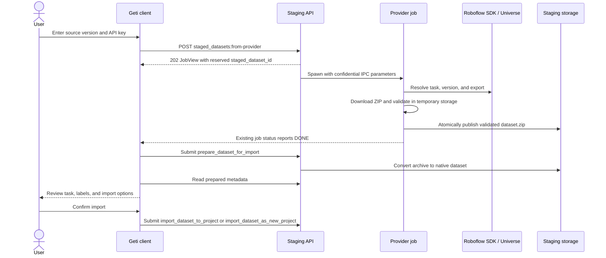
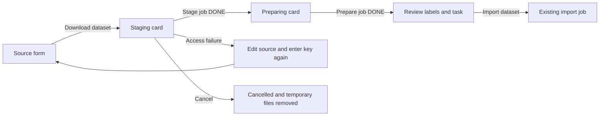

# Roboflow Universe dataset import

- Scope: `application/backend/` (primary), `application/ui/` (separate workstream), `libraries/getitune/` (no provider logic).
- Supersedes: nothing.
- Related docs: [Dataset management](dataset.md), [Jobs](jobs.md), [API](api.md).
- Status: proposed design; this document does not enable the feature.
- Issue: #7910; parent: #6472; classification loader: [#7921](https://github.com/open-edge-platform/geti/pull/7921).
- Structure reference: [OME design on develop](https://github.com/open-edge-platform/geti/blob/develop/application/docs/ome.md).

---

## 1. Context

Geti users should be able to import a specific Roboflow Universe dataset version without downloading and uploading
the archive themselves. External providers enter through dataset staging. The existing preparation and import jobs
remain responsible for conversion, label mapping, filtering, and project writes.

### Requirements addressed

1. Import an explicit Roboflow Universe dataset version into staging without a manual download/upload round trip.
2. Support detection, polygon instance segmentation, and single-label classification with compatible existing loaders.
3. Preserve labels, supported annotations, unannotated images, and train/validation/test membership.
4. Reuse preparation and both project import paths so users can review task and label mapping before importing.
5. Transfer per-request credentials to the worker without exposing them in public responses, logs, or artifacts.
6. Report progress, support cancellation, and clean partial downloads through the existing job lifecycle.
7. Reuse the Roboflow SDK behind a small provider interface that can accommodate another provider later.
8. Define the additive API contract, UI interaction sketches, dependencies, and verification required for implementation.

### Current code and constraints

- [Dataset staging routes](../backend/app/api/routers/dataset_ie.py) accept uploaded ZIP files and expose staged
  dataset lookup and deletion. Existing upload routes return `201` with `StagedDatasetView`.
- [StagedDatasetService](../backend/app/services/staged_dataset_service.py) discovers UUID-named directories.
  Its upload methods allocate their own IDs. Provider staging needs to publish using an ID reserved at submission.
- [PrepareDataset](../backend/app/execution/dataset_import/prepare.py) looks for a ZIP, converts it to the native
  `dataset/` directory, and removes the original archive after successful conversion.
- [The COCO loader](../../libraries/getidata/src/getidata/data_formats/coco/io.py) recognizes Roboflow split folders
  containing `_annotations.coco.json`. This is format recognition, not proof of end-to-end annotation fidelity.
- The [YOLO-Cls importer](../../libraries/getidata/src/getidata/data_formats/yolo/io.py) reads class folders under each split.
  For example, `valid/cat/frame.jpg` supplies the validation split and the label `cat`.
- [JobQueue](../backend/app/core/jobs/control_plane/queue.py) holds jobs in memory.
  [ProcessRun](../backend/app/core/jobs/exec/process_run.py) currently passes `params.model_dump_json()` to a spawned
  Python process. [JobView](../backend/app/api/schemas/jobs/job_view.py) builds public metadata explicitly.
- [The backend lockfile](../backend/uv.lock) resolves `roboflow==1.7.3` through `getitune`.
  [The library manifest](../../libraries/getitune/pyproject.toml) already declares `roboflow~=1.2`.

---

## 2. Decision drivers

- **Reuse dataset staging.** External providers produce the same ZIP input used by the existing preparation job.
  Provider code does not create project items or duplicate conversion and label-mapping behavior.
- **Keep API changes additive.** Uploaded datasets and existing preparation/import contracts continue to work.
- **Include classification from the start.** Consume the YOLO-Cls support from #7921 rather than adding a parallel loader.
- **Keep secrets transient.** Ordinary serialization stays masked; only the trusted worker IPC path reveals the key.
- **Reuse the SDK.** Roboflow-specific resolution and export behavior stay behind one adapter using the existing dependency.
- **Extend only where needed.** Two provider operations are sufficient; additional providers and remote storage are deferred.

### Rejected alternatives

| Alternative                                                    | Why rejected                                                                                                                      |
| -------------------------------------------------------------- | --------------------------------------------------------------------------------------------------------------------------------- |
| Import directly into a project from the provider               | Bypasses staging and the user's opportunity to inspect task and labels before project writes.                                     |
| Reuse the existing `stage_dataset` job                         | That job stages data from an existing Geti project; external resolution, authentication, and download have a different lifecycle. |
| Defer classification from the design                           | The existing YOLO-Cls loader already reads the split and class directories used by Folder structure exports.                      |
| Build a separate Roboflow REST client with `httpx`             | Duplicates SDK behavior and adds another integration to maintain.                                                                 |
| Call `Version.download()` unchanged and re-archive its output  | Extraction occurs before Geti validates the archive; the method also removes the original ZIP.                                    |
| Reveal `SecretStr` in every JSON serialization                 | Exposes credentials to unrelated parameter dumps; limit revelation to explicit IPC serialization.                                 |
| Add a credential database or general provider plugin framework | Neither is needed for a per-request key and one registered provider.                                                              |

---

## 3. Decision

This design incorporates the proposal and maintainer feedback supplied in #7910:

| Topic              | Decision after feedback                                                                                  |
| ------------------ | -------------------------------------------------------------------------------------------------------- |
| Staging            | Add `stage_dataset_from_provider`; keep preparation and project import separate.                         |
| Tasks              | Include detection, polygon instance segmentation, and single-label classification in the initial design. |
| Classification     | Use Roboflow's Folder structure export and the YOLO-Cls importer introduced by #7921.                    |
| API                | Add `POST /api/staged_datasets:from-provider`, with provider-specific source models keyed by `provider`. |
| Authentication     | Accept a per-request key. Keep ordinary serialization masked; reveal only for worker IPC.                |
| SDK                | Reuse `roboflow`; do not implement a second Roboflow REST client using `httpx`.                          |
| Provider interface | Start with `resolve()` and `download()` only.                                                            |
| UI                 | Extend the existing import flow; provide schematic screen mocks and state behavior below.                |

### 3.1 Domain model

| Provider concept                         | Geti responsibility                                                        |
| ---------------------------------------- | -------------------------------------------------------------------------- |
| Workspace, project, and explicit version | A typed source descriptor; never a user-supplied download URL.             |
| Dataset task and export                  | Resolved by the provider; checked against supported conversion paths.      |
| Archive acquisition                      | A new `stage_dataset_from_provider` job with a reserved staged dataset ID. |
| Ready archive                            | An existing staged dataset consumed by `prepare_dataset_for_import`.       |
| Prepared labels and task                 | Existing review and project import behavior.                               |
| API key and signed download URL          | Private runtime state, absent from public job metadata.                    |

### 3.2 New entities

These are proposed backend models and components, not new database tables.

| Entity                                        | Responsibility                                                           |
| --------------------------------------------- | ------------------------------------------------------------------------ |
| `RoboflowUniverseSource`                      | Validated source identifiers with a provider discriminator.              |
| Provider staging request                      | Source plus per-request credentials at the API boundary.                 |
| Provider job parameters and job               | Reserved ID, source, confidential parameters, and lifecycle cleanup.     |
| Provider job metadata                         | Explicit allowlist for `JobView`; no credential fields.                  |
| `ResolvedDataset`                             | Safe resolved metadata plus transient SDK state used only in the worker. |
| Dataset provider interface / Roboflow adapter | `resolve()` and `download()`, with only Roboflow registered initially.   |

### 3.3 Supported tasks and formats

| Source task                 | Roboflow export     | Geti import path                 | Acceptance condition                                                                                           |
| --------------------------- | ------------------- | -------------------------------- | -------------------------------------------------------------------------------------------------------------- |
| Object detection            | `coco`              | Existing COCO loader             | Preserve image labels, boxes, unannotated images, and splits.                                                  |
| Instance segmentation       | `coco-segmentation` | Existing COCO polygon conversion | Preserve polygon geometry and instance identity; reject representations that cannot be represented faithfully. |
| Single-label classification | Folder structure    | YOLO-Cls loader from #7921       | Preserve class folders, image labels, and splits through preparation and both project import paths.            |

The backend selects the export from the resolved source task. The request does not expose an arbitrary export format.
Use `folder` for the classification export. Verify its split layout with the locked SDK in the live import test.
See [Roboflow's classification download example](https://supervision.roboflow.com/datasets/).

For all formats:

- Map `train` to training, `valid`/`val` to validation, and `test` to testing through the existing loader semantics.
  Preserve membership; do not randomly split imported data again.
- Keep unannotated detection and segmentation images available for the existing `include_unannotated` option.
- Validate annotation references and image paths. Do not flatten split directories or merge classes by numeric ID
  without checking the label mapping across splits.
- Reject unsupported RLE/crowd masks, multipart polygons, holes, or other geometry when the current conversion cannot
  preserve them. Do not silently replace masks with boxes or discard instances.
- Reject ambiguous or malformed classification layouts. Do not infer multi-label assignments from duplicate images
  in different class folders.

Semantic segmentation, keypoints, oriented boxes, tracking, multi-label classification, and hierarchical labels are
out of scope. Dataset contents must agree with the resolved task; the provider must not relabel an unsupported task
as detection to make it importable.

### 3.4 End-to-end flow



Provider staging never creates projects or dataset items. Preparation remains a distinct job, so conversion failures
are distinguishable from download failures. The client may start preparation automatically after staging succeeds,
but must wait for preparation to finish before showing detected labels or submitting an import.

### 3.5 Provider interface and SDK boundary

Use a small backend provider module with two operations, expressed here as conceptual signatures:

```text
resolve(source, credentials, report) -> ResolvedDataset
download(resolved, destination, report) -> Path
```

`resolve()` authenticates, resolves the explicit version and source task, and selects the supported export.
`ResolvedDataset` holds safe source metadata and private runtime state needed to obtain the archive. SDK instances,
credentials, and signed links are transient, never serializable job metadata. `download()` returns a complete local
ZIP at a backend-owned destination. The report callback checks cancellation as well as reporting progress.

The provider owns Roboflow-specific API behavior. The staging execution owns temporary directories, archive checks,
publication, and cleanup. Providers do not know about projects, label mapping, or database repositories. A fixed
mapping registers only `roboflow_universe`; unknown providers fail validation.

#### SDK integration

Use `Roboflow(api_key=...)`, explicit workspace/project lookup, and the requested version for metadata resolution.
The SDK remains the integration dependency, as requested in review. However, its documented
[`Version.download()`](https://docs.roboflow.com/datasets/create-and-upload/download-a-dataset) fetches **and extracts**
the dataset. It is not an archive-only staging API.

Inspection of the lockfile's hash-verified `roboflow` 1.7.3 wheel confirms that `download()` invokes ZIP extraction,
removes `roboflow.zip`, and can print a signed download link on failure. Its export loop also needs an external time
budget. Calling it unchanged, then zipping the result, would validate too late and duplicate disk work.

The proposed adapter therefore uses the SDK's `roboflow.adapters.rfapi.get_version_export()` operation to obtain export
status and the download link, with bounded polling in the provider. This is a lower-level SDK dependency: isolate it
inside the Roboflow adapter and cover it with contract tests against the locked version. Do not call name-mangled
private download methods or monkey-patch SDK globals.

Download the resulting archive with a small standard-library HTTP transport that streams bytes to the job's file,
enforces the limits in section 3.7, and validates redirects before following them. This transport handles archive bytes
only; it does not duplicate Roboflow authentication, task discovery, or export REST endpoints. If SDK support for
archive-only streaming becomes available, replace this transport behind `download()` without changing callers.

### 3.6 Credentials and worker serialization

Adopt the two serialization modes suggested in review instead of introducing a separate credential store or a new
runtime context hierarchy. The following is an illustrative extension of `JobParams` plus the provider parameter
model's serializer; source and staged ID fields are omitted from this example:

```python
from pydantic import BaseModel, SecretStr, SerializationInfo, field_serializer


class JobParams(BaseModel):
    def to_ipc_json(self) -> str:
        return self.model_dump_json(context={"reveal_secrets": True})


class ProviderJobParams(JobParams):
    api_key: SecretStr | None

    @field_serializer("api_key", when_used="json")
    def serialize_api_key(self, value: SecretStr | None, info: SerializationInfo) -> str | None:
        if value is None:
            return None
        if (info.context or {}).get("reveal_secrets"):
            return value.get_secret_value()
        return "**********"
```

The API requires a key; internal parameters allow `None` only to support releasing credentials after use. Execution
rejects a missing key. Ordinary JSON serialization stays masked; Python dumps retain a `SecretStr`, not plaintext.
See [Pydantic serialization context](https://docs.pydantic.dev/latest/concepts/serialization/#serialization-context).

Change the single process-launch serialization call to `params.to_ipc_json()`. The resulting JSON travels only as
Python multiprocessing spawn data, not as a command-line argument, environment variable, log, file, or API response.
The worker validates it with its normal parameter model. This is an intentional trusted-process boundary, not
encryption or a guarantee against a local administrator reading memory.

Required lifecycle and leakage controls:

- Hold the key in the pending in-memory job until dispatch. Clear the parent's reference after successful spawn;
  clear worker references as soon as provider access is finished. Python cannot guarantee secure memory erasure.
- Clear credentials on submission/spawn failure, normal completion, failure, running cancellation, and cancellation
  before dispatch. The current `Job.cancel()` skips `on_complete()` for never-started jobs, so a hook only in
  `on_complete()` is insufficient. Cover that pending path explicitly in the terminal-state handling.
- Never persist raw parameters or IPC JSON. Restart does not resume provider jobs or recover keys; users resubmit.
- Suppress raw SDK stdout/stderr, and translate SDK failures to safe messages before they reach execution logging.
  The inspected SDK sends keys in query strings for some calls; do not retain the proposal's bearer-only assumption.
  Treat full request URLs, response bodies, signed links, and exception text as potentially secret.
- The runner currently sends `traceback.format_exc()` on failure. Sanitize provider errors before that boundary,
  suppress unsafe exception chaining, and prevent diagnostic logging from dumping payloads or local variables.
  Redaction tests must cover validation errors, worker logs, SSE, job responses, and failed-spawn diagnostics.
- Download clients carry no Roboflow API key, authorization header, or authenticated session cookies. Keep signed
  URLs only in worker memory and never forward credentials across redirects.

Saved credentials and OAuth remain follow-up work. The UI clears the key after successful submission or closing the
form and never places it in local storage, session storage, URLs, analytics, or persisted import state.

### 3.7 Staging, failure handling, and cancellation

Create a job-owned temporary directory on the staging filesystem under a non-UUID temporary parent. It must not be
visible through `StagedDatasetService.list_all()`. Stream to `dataset.zip.part`, close and validate it, then prepare a
directory containing only `dataset.zip`. Atomically rename that directory to the reserved UUID directory. Do not call
`upload_from_path()` unchanged: it generates a different ID. Add a narrow publication helper accepting the reserved ID,
with no overwrite of an existing dataset.

Before publication, validate ZIP structure and integrity, member paths, permitted dataset layout, and resource limits.
Reject absolute/drive/UNC paths, parent traversal, links, special files, duplicate or case-colliding destinations, and
paths escaping the extraction root. Inspect annotation-referenced image paths too. The preparation extractor must
honor the same constraints; post-download validation is not a replacement for safe extraction.

All network calls need finite timeouts; polling and retries need a total deadline and cancellation checks. Reuse
applicable settings and upload limits where available. Proposed provider defaults, to confirm during implementation,
are a 10-second connect timeout, 60-second read timeout, 30-minute total staging deadline, and three retries with
backoff for transient network errors, `429`, and retryable `5xx`. Respect `Retry-After` within the total deadline.
Set explicit compressed-byte, uncompressed-byte, member-count, and compression-ratio ceilings through the settings
layer before shipping; test each limit. Missing `Content-Length` does not disable byte limits.

Accept no user-supplied download URL. SDK-provided URLs are still untrusted network input: require HTTPS, validate
approved Roboflow/download hosts and every redirect, and block loopback, private, link-local, and metadata-service
destinations after DNS resolution. The transport must prevent DNS rebinding between validation and connection. Verify
actual CDN hosts during the live contract test; do not assume an arbitrary HTTPS URL is safe.

Check cancellation during export polling, transfer, validation, and immediately before publication. Use the existing
runner's terminate/kill fallback for blocking SDK calls. Worker `finally` cleanup is insufficient after termination:
the parent terminal hook must remove the job-owned temporary directory after the worker exits. If cancellation wins
the publication race, remove that job's published directory before reporting `CANCELLED`; never remove another job's
staging directory. On startup, remove orphaned provider temporary directories, without deleting valid staged datasets.

| Failure                                               | User-visible outcome                             | Retry behavior                                             |
| ----------------------------------------------------- | ------------------------------------------------ | ---------------------------------------------------------- |
| Missing/invalid request fields                        | HTTP `422`, safe field errors                    | Correct input before submission.                           |
| Invalid key or unavailable version                    | Job `FAILED`, safe access error                  | Re-enter key or source; no automatic authentication retry. |
| Unsupported task or annotation representation         | Job `FAILED`, specific supported-format guidance | No automatic retry.                                        |
| Pending export, throttling, temporary network failure | Job remains `RUNNING` within budget              | Bounded polling/retry; fail when budget expires.           |
| Invalid ZIP, resource limit, or disk exhaustion       | Job `FAILED`, no published partial dataset       | Clean temporary files; user resolves cause.                |
| Cancellation                                          | Existing `CANCELLING` then `CANCELLED` lifecycle | Clean files and credentials; explicit resubmission only.   |
| Prepare/import failure                                | Existing job failure behavior                    | Do not automatically replay a project import.              |

Provider failures use existing `JobView.error` and `message` fields; no new global error envelope is required.
Repeated POST requests create independent jobs and IDs; the UI disables duplicate submission. There is no new
deduplication or resumable-download contract. Project import creates items incrementally, so automatic retry can
duplicate partial results. Tell users to inspect the target project before retrying a failed import.

### 3.8 UI interaction mocks

These wireframes show the existing-project path with example data. Both entry points share the source and progress screens.
The new-project review uses project name, task selection, and import filters.

#### Source form

```text
Import dataset
Source        ( ) Upload file    (•) Roboflow Universe
Workspace     [ vision-lab                         ]
Project       [ road-signs                         ]
Version       [ 3                                  ]
Private key   [ ••••••••••••••••                   ] [Show]
              Used for this download only.
                              [Cancel] [Download dataset]
```

Use separate slug fields initially; URL parsing and browsing/searching Universe are outside this change. Add the source
choice to both the dataset import entry point and the new-project import dialog. Show validation beside the relevant
field; preserve non-secret fields on errors. Do not ask users to select an export format.

#### Import card while staging and preparing

```text
Import dataset                         vision-lab / road-signs · v3
Downloading dataset                    6 MB of 10 MB       [Cancel]
```

Show indeterminate progress while the total is unknown. Switch the label to “Preparing dataset” during conversion.
After a cancel request, disable the button and display “Cancelling…”. On access failure, show “Check your source
and API key” with an **Edit source** action that opens an empty key field.

Use [the existing preparation component](../ui/src/components/prepare-import-dataset/prepare-import-dataset.component.tsx)
and import status cards as the pattern. Subscribe to the provider job first, then switch to the preparation job. Store
only safe source fields, IDs, and phase in the existing import state. Closing a running progress dialog does not imply
cancellation; users can return through the import job list.

#### Review before project import

```text
Review dataset                         vision-lab / road-signs · v3
Object detection                       24 images · 30 annotations

Dataset label                          Project label
stop                                   [ Stop sign        ▾ ]
yield                                  [ Yield sign       ▾ ]
[x] Include unannotated images

                                        [Back] [Import dataset]
```

Populate counts and labels from the prepared dataset. For an incompatible project task, explain the mismatch
and disable **Import dataset**.

Do not show fabricated split counts: current metadata does not expose them. Preserve splits in the backend and use
existing subset filters where available. Keep source attribution/license information available when supplied by the
provider; importing does not grant additional rights to use the dataset.



Add `staging` to [the import state types](../ui/src/shared/import-dataset-state.ts) while retaining the current upload
and preparation states. Keep errors understandable without exposing SDK internals. Dialog focus, field labels,
keyboard navigation, screen-reader progress announcements, and error focus follow existing accessible components.

---

## 4. Schema changes

### 4.1 Job models

Add `STAGE_DATASET_FROM_PROVIDER` to `JobType`, a provider staging job, and its parameter model. Extend the base
`JobParams` with the IPC serialization method described in section 3.6. Keep the source descriptor in the domain
layer so worker and service code do not import API request schemas.

### 4.2 API schemas

Add the provider staging request and public metadata model. Extend the metadata union and `JobView.of()` to represent
the new job. The request's `source.provider` identifies its source schema; section 5.1 defines validation and how the
schema extends to future providers. Regenerate OpenAPI and UI types as part of implementation.

### 4.3 Unchanged

Project, media, annotation, and dataset database tables remain unchanged. Reuse `StagedDataset` and
`StagedDatasetView`, along with the existing prepare/import request schemas. Credentials and signed URLs are not
added to persistent models.

### 4.4 Migration

No Alembic migration or data backfill is required. Provider jobs use the existing in-memory queue and produce the
existing staged ZIP layout. Jobs interrupted by a backend restart are not resumed; orphaned temporary files are
cleaned without deleting valid staged datasets.

---

## 5. API contract

### 5.1 Provider staging request

```http
POST /api/staged_datasets:from-provider
Content-Type: application/json
```

```json
{
  "source": {
    "provider": "roboflow_universe",
    "workspace": "workspace-slug",
    "project": "project-slug",
    "version": 3
  },
  "credentials": {
    "api_key": "<private-api-key>"
  }
}
```

Define a `RoboflowUniverseSource` model with `provider: Literal["roboflow_universe"]`, nonempty workspace/project
slugs, and a strict positive integer version. Reject path separators, URL syntax, control characters, and unknown
fields. Require a nonempty `SecretStr` API key. Never infer a workspace from the key or select the latest version.

The `source.provider` value selects the source model and provider implementation. Only the Roboflow model exists
initially; use that concrete model while there is one variant, then a Pydantic discriminated union keyed on
`provider` when a second variant exists. This avoids a fake second provider solely to construct a union. Credentials
remain a separate request field and are validated for the selected provider.

The handler validates input, reserves `staged_dataset_id`, constructs the job, and submits it to the existing queue.
It performs no network calls. Reject malformed input with `422` and redact credential input from validation error
bodies and request logging; `SecretStr` alone does not sanitize raw invalid input in validation errors.

### 5.2 Response and lifecycle

Return `202 Accepted` with the existing `JobView` shape. Example immediately after submission:

```json
{
  "job_id": "711c8444-e259-49f5-bc19-d3eb8d03df7d",
  "job_type": "stage_dataset_from_provider",
  "metadata": {
    "staged_dataset_id": "59760ec4-5f44-49cb-b6aa-9ca5e261ef2f",
    "source": {
      "provider": "roboflow_universe",
      "workspace": "workspace-slug",
      "project": "project-slug",
      "version": 3
    }
  },
  "status": "PENDING",
  "progress": 0.0,
  "message": null,
  "error": null,
  "started_at": null,
  "finished_at": null
}
```

Extend `JobType`, `JobView.of()`, and the metadata union for this new job. Public metadata is an explicit allowlist:
reserved ID and source identifiers, with optional resolved task/export format after resolution. It contains no API
key, credentials object, signed URL, SDK object, or IPC payload. Keep existing uppercase status values.

Use the existing job list, detail, status/SSE, and cancellation endpoints. Progress messages identify resolution,
export preparation, download, validation, and publication. Use indeterminate UI progress when byte totals are unknown;
never claim precise download progress from a timer.

The staged resource is absent from listing and returns `404` until publication. A reserved ID is not a ready dataset.
`DONE` means a validated ZIP has been published and can enter `prepare_dataset_for_import`; it does not mean project
import has completed. Existing multipart and resumable upload contracts remain unchanged.

There is one submission entry point for this job: the new staging route. No duplicate submission form under
`POST /api/jobs` is needed. The existing prepare/import request schemas remain unchanged. Regenerate the UI OpenAPI
spec and TypeScript definitions when implementing this additive contract.

---

## 6. Library impact

**No provider logic in `getitune`.** Once preparation produces the native dataset, existing training, evaluation,
quantization, and model export paths consume it normally. No changes to model recipes or training APIs are proposed.

**Conversion support in `getidata`.** Reuse the COCO loader and consume the YOLO-Cls importer from #7921.
Any conversion change must be justified by a failing fidelity fixture and tested in the shared loader. Do not add
Roboflow-specific branches to project import or a second classification importer in the backend.

### Dependencies and packaging

Add `roboflow` as an explicit backend dependency when the backend imports it, matching the existing compatible
constraint. Refresh the lockfile through the repository workflow; retain existing dependency overrides. Lazy-import
the adapter in the worker builder, and check PyInstaller packaging. No new `httpx` dependency is needed for this design.

---

## 7. Cloud scalability

What this design enables:

- Another provider can implement `resolve()` and `download()` and add its typed source variant without changing
  preparation or project import. Each provider still needs its own authentication, format, and safety tests.
- Resolving source metadata separately from downloading isolates provider behavior from staging and project storage.
- Existing job concurrency controls bound provider work; streaming avoids loading an entire archive into memory.

What is deliberately deferred:

- Hugging Face or other provider implementations, dataset search, and provider discovery.
- Remote object storage, distributed workers, persistent job queues, resumable downloads, and cross-job caching.
- Saved credentials or a cloud secret-management service.

The current implementation remains local: workers publish an archive on the backend staging filesystem and receive
credentials through local process IPC. Moving workers or staging to another host requires a storage and confidential
transport design; the two-method provider interface alone does not solve that transition.

---

## 8. Implementation plan

Each step below describes future implementation, not changes included with this document. Keep changes scoped and
merge them with their relevant checks passing.

### Step 1 - Confirm format and SDK contracts

Verify the `folder` export with the existing YOLO-Cls loader. Check COCO polygon fidelity, SDK export status behavior,
and approved download hosts against the locked SDK. Record tiny representative fixtures.

_Testing._ Run loader fixtures for each supported task. Verify SDK resolution and ready/pending export contracts
against the locked version. Use a separately opt-in live check to confirm the classification identifier and CDN hosts.

### Step 2 - Confidential IPC serialization

Update `JobParams` and `ProcessRun`; add lifecycle credential release and safe error handling.

_Testing._ Verify default masking, IPC round-trip in a real spawned worker, and unchanged serialization for existing
training, export, prepare, and import jobs. Cover pending cancellation, spawn failure, worker errors, and all public
or logged output surfaces separately.

### Step 3 - Provider staging and API

Add source/request/metadata schemas, the staging route, domain job parameters, provider adapter, execution, and
publication helper. Register the lazy builder in `execution/builders.py` and `lifecycle.py`. Keep API schemas out of
service/execution models. Add settings for actual transfer limits, declare SDK usage directly, and regenerate the
OpenAPI spec and UI types in the same change set.

_Testing._ Exercise `202` responses, strict validation, SDK failures, bounded retries, archive and network safeguards,
atomic publication, cancellation races, and forced-termination cleanup. Run upload regressions and the UI type checker
against the regenerated contract. Smoke-test the lazy SDK import in normal and PyInstaller distributions.

### Step 4 - End-to-end import

Feed each supported fixture through staging, preparation, and both existing-project and new-project imports.
Fix only conversion gaps demonstrated by these fixtures. Update shared loader tests if a loader changes.
Keep project import free of provider-specific branches.

_Testing._ Assert labels, supported geometry, unannotated-image behavior, and split membership for all three tasks
and both destinations. Cover mapping, filtering, task mismatch, and partial failure without automatic replay.
Use an opt-in live import and minimal training smoke test as the external integration check.

### Step 5 - UI and contract handoff

Add provider staging state, the source form, mocked jobs, failure/cancel states, and both entry points.
Reuse the existing review and label-mapping screens. Keep generated API types aligned and update user-facing
API/dataset/job documentation when the feature becomes available.

_Testing._ Run affected UI unit tests, type checking, formatting, and lint. Verify duplicate-submit prevention,
staging/preparing transitions, an empty key on retry, cancellation, keyboard navigation, and screen-reader behavior.

### Required test coverage

| Layer            | Verification                                                                                                                                                                                                     |
| ---------------- | ---------------------------------------------------------------------------------------------------------------------------------------------------------------------------------------------------------------- |
| API              | `202` and valid public metadata; strict source/version validation; unsupported provider; no raw credential in `422`; unchanged uploaded ZIP and resumable upload paths.                                          |
| Provider         | Mock SDK resolution/export; ready and pending exports; invalid key; missing version; unsupported task; rate limits; exhausted retries; missing byte totals.                                                      |
| Transfer/staging | Interrupted stream, timeouts, disk full, limits, redirects/SSRF, ZIP traversal and links, CRC failure, reserved ID, atomic visibility, cancellation during transfer and publication, forced termination cleanup. |
| Conversion       | Boxes, polygons, labels, unannotated images, class folders, split membership, identical filenames across splits, and explicit rejection of unsupported geometry.                                                 |
| Project import   | Both destinations; label mapping; task compatibility; filtering; partial failure does not trigger replay.                                                                                                        |
| Secrets          | Default JSON/Python dumps, IPC round-trip, validation bodies, job list/detail/SSE, SDK output, chained errors, diagnostic logs, artifacts, and terminal-state credential release.                                |
| UI               | Both entry points; duplicate-submit prevention; staging/preparing transitions; task mismatch; empty key on retry; cancellation; keyboard and screen-reader behavior.                                             |
| Packaging        | Worker starts with lazy SDK import in normal and PyInstaller distributions.                                                                                                                                      |

Use tiny deterministic Roboflow-layout fixtures and mocked SDK/network responses in normal CI. Add a separately
opt-in live test using a supplied key: resolve and download one version for each supported task, prepare/import it,
and run a minimal training smoke test. Never require credentials or live Universe availability for unit tests.

During implementation, run the narrow affected backend tests, then the backend lint/type/import checks. When UI types
or components change, run generation, type checking, formatting/lint, and affected unit tests. A documentation-only
change needs Markdown formatting/lint, link checks, and `git diff --check`; it does not require training or UI builds.

The first implementation is complete when all three supported tasks pass both import paths, secrets cross only the
intended IPC boundary, cancellation leaves no partial staged dataset, and the existing upload workflow still passes.

---

## 9. Risks

| Risk or unresolved detail                   | Required resolution                                                                                                                                             |
| ------------------------------------------- | --------------------------------------------------------------------------------------------------------------------------------------------------------------- |
| Classification export layout differs        | Run a Folder structure fixture through preparation and both project import paths.                                                                               |
| SDK lower-level export adapter changes      | Keep usage local to the provider and test against the locked wheel. Reassess on dependency upgrades.                                                            |
| SDK timeout/cancellation gaps               | Verify transport controls and enforce an overall deadline with runner termination as fallback. Do not claim cooperative cancellation inside an opaque SDK call. |
| Secrets in SDK errors or runner diagnostics | Test every output surface with sentinel secrets and signed URLs before enabling the endpoint.                                                                   |
| Archive/CDN safety and disk budgets         | Confirm host policy, connection-time address validation, and concrete byte/member limits before release.                                                        |
| Unsupported segmentation geometry           | Fail clearly; add conversion only with geometry-preservation tests.                                                                                             |
| Interrupted project import                  | Reuse existing behavior and require explicit user recovery; do not promise transactionality or automatic rollback.                                              |

---

## 10. Out of scope

- Semantic segmentation, keypoints, oriented boxes, video tracking, multi-label classification, and hierarchical labels.
- Automatic conversion of unsupported segmentation geometry into boxes or incomplete polygons.
- Saved credentials, OAuth, credential persistence, and recovery of keys after a backend restart.
- Dataset search, Universe browsing, automatic latest-version selection, and arbitrary download URLs.
- Additional providers, including Hugging Face, and a general provider plugin framework.
- Remote storage, distributed execution, resumable downloads, shared caches, and request deduplication.
- Transactional rollback or automatic replay of a partially completed project import.
- Changes to `getitune` training behavior or model recipes.
- UI implementation in the backend workstream; section 3.8 supplies interaction sketches for the separate UI work.
